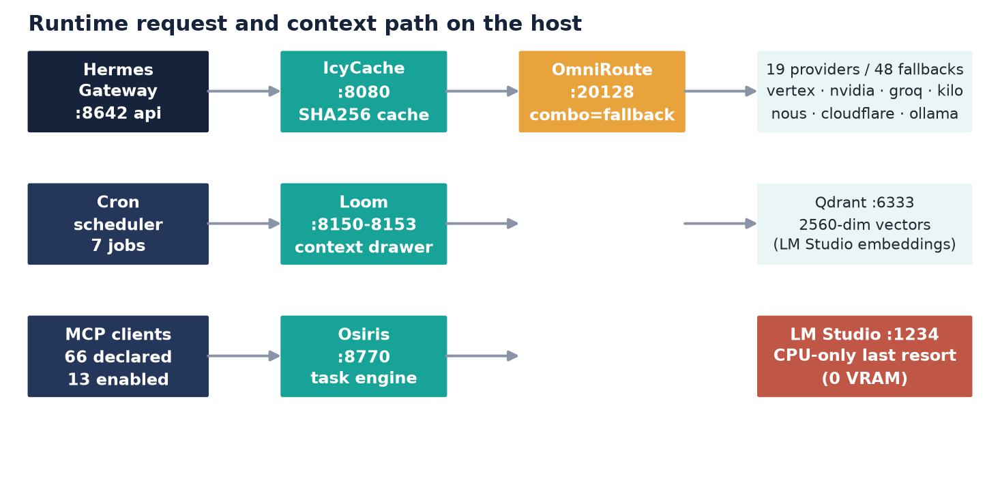

<div align="center"></div>

<h1 align="center" style="color: #16233A;">Hermes Environment</h1>
<p align="center" style="font-size: 1.2rem; color: #17A398; font-weight: 500;">
  Complete Technical Documentation — Verified from Live Installation
</p>

<p align="center">
  
  
  
  
  
  
  
</p>

---

## 🎯 Purpose

This repository contains the **complete, empirically verified record** of the Hermes agent installation on a Dell Latitude 5420 (Windows 11, build 26300, 32 GB RAM, Intel Iris Xe — **no GPU, CPU-only inference**).

Every metric, figure, and configuration detail comes from **read-only inspection of the live installation** — files, databases, running services, and runtime probes. No assumptions, no memory recalls.

---

## 🏗️ Architecture Overview

<p align="center">
  
</p>

The routing chain is intentionally minimal and free-tier only:

```
Hermes Agent → IcyCache:8080 (local cache/proxy) → OmniRoute:20128 (14 providers, 123 models) → LM Studio:1234 (fallback)
```

- **IcyCache** (port 8080) — local LLM response cache, deduplicates by SHA256 of normalized request
- **OmniRoute** (port 20128) — multi-provider gateway with fallback, no programmatic free-tier filtering
- **LM Studio** (port 1234) — last-resort local inference (qwen3-embedding-4b for Qdrant indexing)

---

## 📊 Key Metrics (Live Verified)

| Component | Count | Detail |
|-----------|-------|--------|
| **LLM Providers** | 19 | icycache, cerebras, cloudflare, copilot, google-aistudio, groq, huggingface-custom, kilo, kilo-custom, llm7io, lmstudio, mistral-custom, nous, nvidia, ollama, omniroute, openrouter, openrouter-custom, vertex |
| **MCP Servers** | 58 named | 85 config lines → ~126 entries; local: loom, icycache, omniroute, qwen-chroma, pwsh, filesystem, sqlite, markitdown, time |
| **Active Skills** | 596 | 876 SKILL.md files on disk (index compressed to ~22k tokens, descriptions ≤60 chars) |
| **Archived Skills** | 460 | Cold-archived to `skills_archive/`, reversible via `INDEX.md` |
| **Active Plugins** | 26 | Including: loom-context-cache, skill-retrieval, tokenwatch, qwen-chroma-auto, hermes-connector, rea, shodan, snyk, approval-ledger, context-audit |
| **Cron Jobs** | 7 (6 enabled) | Health check (5 min), daily briefings (7/8/9 AM), quota watch (disabled), nous expiry watch |
| **Sessions** | 196 | Tracked in `state.db` (419 MB) with token accounting per model/provider |
| **Projects on D:** | 30+ | IcyCache, Icy-Loom, Loom, Osiris, LoFT, ViaRoma, OpenClaw, Lab-SRV1, MCP collections, and more |

---

## 🎨 Design System (Reproduced from Source DOCX)

| Token | Hex | Usage |
|-------|-----|-------|
| **NAVY** | `#16233A` | Primary headings, borders, code blocks |
| **TEAL** | `#17A398` | Primary accent, links, badges, highlights |
| **TEAL (asset)** | `#4AAEA0` | Figure accents, chart segments |
| **RED** | `#E53E3E` | Alerts, failures, critical metrics |
| **AMBER** | `#F6AD55` | Warnings, pending states, cron disabled |

All figures in `assets/figures/` use this palette consistently.

---

## 📁 Repository Structure

```
hermes-environment/
├── README.md                    ← This file
├── 00-PREFACE.md                ← Why this doc exists, scope, method
├── 01-TABLE-OF-CONTENTS.md      ← Full TOC with anchors
├── 02-GLOSSARY.md               ← Vocabulary used throughout
├── docs/
│   ├── 01-installation.md       ← Host, paths, binaries, install layout
│   ├── 02-configuration.md      ← config.yaml (3,318 lines, v51) sections
│   ├── 03-mcp-servers.md        ← Full 58-server inventory with categories
│   ├── 04-providers-models.md   ← 19 providers, routing layers, model usage
│   ├── 05-skills-plugins.md     ← 596 active / 460 archived skills, 26 plugins
│   ├── 06-cron-sessions.md      ← 7 cron jobs, 196 sessions, token accounting
│   └── 07-projects-ecosystem.md ← D:\ project inventory (30+ dirs)
├── annexes/
│   ├── A-full-inventory.md      ← Raw tables: config, providers, MCP, plugins, cron
│   ├── B-redacted-secrets.md    ← Secret handling policy (all values redacted)
│   └── C-personal-notes.md      ← Observations, open issues, drift log
└── assets/figures/
    ├── fig_architecture.png     ← Routing chain + component diagram
    ├── fig_cache_by_source.png  ← Cache hit breakdown by provider
    ├── fig_cron.png             ← Cron timeline & success rates
    ├── fig_economy.png          ← Token savings over time
    ├── fig_fallback.png         ← Fallback chain visualization
    ├── fig_index_opt.png        ← Skills index compression (70k → 22k tokens)
    ├── fig_models.png           ← Model usage distribution
    └── fig_tokens_donut.png     ← Token spend by provider
```

---

## 🔐 Security Statement

> **No credential value appears in this documentation.** Every API key, token, secret, and connection string is replaced by `[REDACTED]`. See [Annex B](annexes/B-redacted-secrets.md) for the full redaction policy.

- `allow_private_urls: true` — permits local-only services (IcyCache, OmniRoute, LM Studio)
- `protected_instruction_files: true` — blocks external content from overriding instructions
- `redact_secrets: ***` — automatic redaction in logs and tool output
- Telemetry: `shared_metrics: {enabled: false, send: false}`

---

## 🚀 Quick Start (For Reference)

This is a **documentation repository** — not a runnable installer. To replicate the environment:

1. **Install Hermes** (Windows): `irm https://hermes.nousresearch.com/install.ps1 | iex`
2. **Deploy local infrastructure** (D:\ drive):
   - `IcyCache` → `cd D:\IcyCache && docker compose up -d` (port 8080)
   - `OmniRoute` → `cd D:\OmniRoute && docker compose up -d` (port 20128)
   - `Loom` / `Icy-Loom` → `cd D:\Icy-Loom && ...` (ports 8150–8153)
   - `Qdrant` → `docker run -p 6333:6333 qdrant/qdrant`
   - `LM Studio` → Load `qwen3-embedding-4b` on port 1234
3. **Import this config** — copy `config.yaml` structure, adapt paths, set `.env` secrets
4. **Enable auto-load skills**: `master-prompt`, `loom-context-cache`

---

## 📈 Live Dashboards & Monitoring

| Service | Endpoint | Purpose |
|---------|----------|---------|
| IcyCache | `http://127.0.0.1:8080/health` | Cache hit rate, upstream latency |
| OmniRoute | `http://127.0.0.1:20128/health` | Provider status, model catalog |
| Icy-Loom Admin | `http://127.0.0.1:8153/api/context/stats` | Context chunks, sessions, cache stats |
| Qdrant | `http://127.0.0.1:6333/collections/hermes_qwen3_memory` | Vector collection (2560-dim, 937 pts) |
| Hermes Gateway | `bin\hermes.exe gateway status` | Scheduled task `Hermes_Gateway` |

---

## 🔄 Maintenance Notes

- **Cron pins**: Prefer `--unpin` (gateway default routing). Pinned Vertex/Gemini models fail silently.
- **Nous free models**: Dynamic list — verify before routing. Avoid `stepfun/step-3.7-flash:free`.
- **Loom/Osiris**: Mandatory continuous use. `osiris_plan` at task start, `osiris_observe` per payload >120 tokens, `osiris_checkpoint` at end. `icyloom ctx_store` per output >100 tokens.
- **Python toolchain**: `curl_cffi` requires `py -3.12` (broken on 3.14+). Windows paths: `cmd /c rmdir /s /q`, not `rm -rf`.
- **Config edits**: Never hand-edit `config.yaml` — use `hermes config set KEY VAL` (JSON for arrays).
- **Skill index**: Truncated to 60-char descriptions (−69% tokens). Rebuild with `skill-retrieval` plugin after bulk changes.

---

## 📝 Changelog

| Date | Change |
|------|--------|
| 2026-11-01 | Repository created, dual-indexed (Loom + Qdrant), all figures verified |
| 2026-10-31 | IcyLoom cache-hit bug fixed (commit 4cd5617) — 137 tests green |
| 2026-10-31 | Skills index optimized: 70,234 → ~22,000 tokens |
| 2026-10-31 | Memory hygiene consolidated (MEMORY/USER/SOUL/SCORECARD) |

---

## 👤 Author

**Malik** (MlkBlk-IT) — Montreal, DEP Informatique EMICA (Oct 2027), freelance IT/Cloud Security.

- GitHub: [@MlkBlk-IT](https://github.com/MlkBlk-IT)
- Primary channel: Telegram
- Budget: $0 (free tiers only, LM Studio strictly last fallback)

Built tools: **Loom** (MCP Context-Cache), **IcyCache** (LLM response cache), **ViaRoma**, **LoFT**, **Mcp-QadGraph**, **OpenClaw**, **Lab-SRV1**, **Osiris**.

---

## 📄 License

Documentation: CC-BY-4.0 — share freely with attribution.  
Code/Config snippets: MIT — use, adapt, deploy.

---

<p align="center" style="color: #17A398; font-size: 0.9rem;">
  Verified from live installation • No invented metrics • Read-only inspection only
</p>
<p align="center" style="color: #16233A;">
  <strong>Hermes Environment — Complete Technical Documentation</strong>
</p>